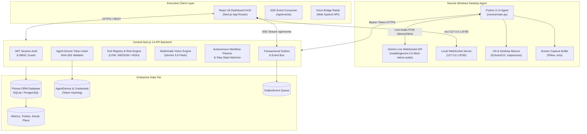

# JARVIS LITE + NEXORA UNIFIED SYSTEM ARCHITECTURE

## 1. Executive Summary

JARVIS LITE + NEXORA is a hybrid enterprise operating system that unifies a modern web-based Executive Business Operating System with a multimodal Windows Desktop & Voice Assistant powered by Google Gemini Live API.

- **JARVIS LITE (The Business Brain)**: Next.js 14 App Router, TypeScript, Prisma ORM, Tailwind Glassmorphism HUD. Manages business metrics, CRM support tickets, social media broadcasting, Meta ads, subscription tiers, and multi-tenant RBAC.
- **NEXORA (The Desktop & Voice Brain)**: Embedded Python 3.14 agent, Gemini Live bidirectional WebSocket audio streaming, Windows desktop automation (PyAutoGUI, App control), computer vision, and local WebSocket bridge (`ws://127.0.0.1:8765`).
- **CENTRAL EVENT & OUTBOX GATEWAY**: Transactional Outbox pattern in Prisma database + Server-Sent Events (SSE) streaming real-time operational events to connected browser tabs and desktop daemons.
- **SHARED AI TOOL REGISTRY & RISK ENGINE**: Least-privilege permission validation with real-time risk guards (LOW, MEDIUM, HIGH) requiring explicit user confirmation before executing disruptive system actions.

---

## 2. System Architecture Diagram

---

## 3. Communication Protocols

1. **Browser to Backend**: HTTPS / JSON with `jarvis_session` HTTP-only JWT cookies.
2. **Nexora to Backend**: HTTPS / JSON with `Authorization: Bearer <accessToken>` hashed device tokens.
3. **Backend to Browser**: Server-Sent Events (`text/event-stream`) for zero-latency notification of mutations (metrics, tickets, posts, paired devices, tasks).
4. **Browser to Nexora**: Local WebSocket (`ws://127.0.0.1:8765`) for ultra-low latency workstation audio commands and status sync.
5. **Nexora to Gemini Live**: Direct Bidirectional WebSocket streaming 16kHz PCM audio upstream and receiving 24kHz PCM audio downstream.

---

## 4. Multi-Tenant Isolation & Security Boundaries

- Every business entity (`RevenueRecord`, `BusinessMetric`, `SupportTicket`, `SocialPost`, `AgentDevice`, `AgentTask`, `VisionSession`, `OutboxEvent`) is bound to an `Organization`.
- All backend routes enforce `where: { organizationId }` scoping extracted from verified JWT session payloads or authenticated device records.
- Plaintext device tokens are never stored in the database. Tokens are hashed with SHA-256 before persistence and lookup.
