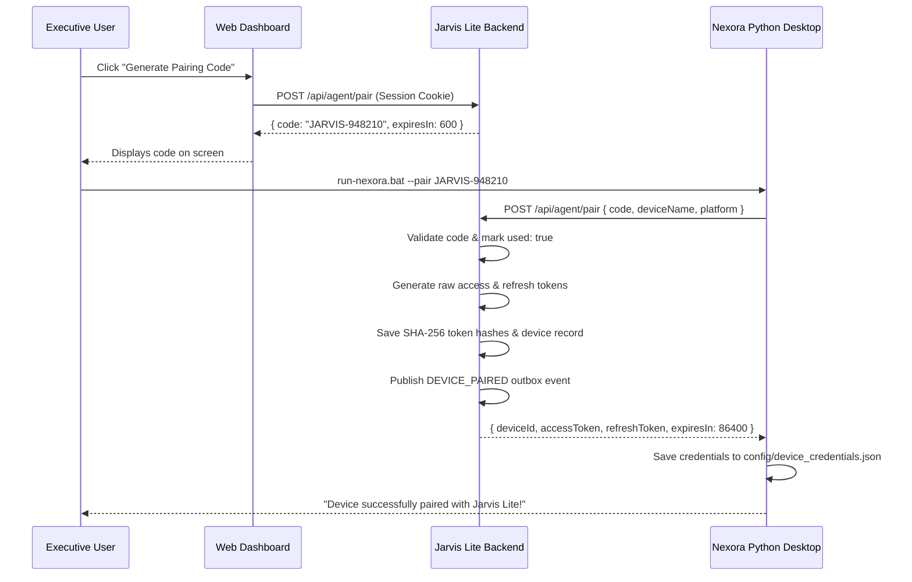

# AGENT DEVICE PAIRING & TOKEN LIFECYCLE

## 1. Security Design Principles

- **Zero Plaintext Secrets**: The backend never stores plaintext permanent API keys or long-lived desktop tokens.
- **Single-Use Cryptographic Handshake**: Pairing codes are short-lived (10 minutes) and invalidated upon the first pairing attempt.
- **SHA-256 Hash Matching**: Incoming Bearer tokens are hashed with SHA-256 before querying the database credential table.
- **Granular Scopes**: Devices are only granted authorized permissions (e.g. `metrics:read`, `tickets:write`, `desktop:control`, `vision:upload`).

---

## 2. Pairing Sequence Diagram

---

## 3. Token Rotation Protocol

When an access token approaches expiration:
1. Nexora sends `POST /api/agent/token/refresh` with `{ deviceId, refreshToken }`.
2. Central backend verifies the SHA-256 hash of the refresh token.
3. Central backend generates a new access token and rotated refresh token, updating the credential record.
4. Nexora replaces its local cached tokens.
