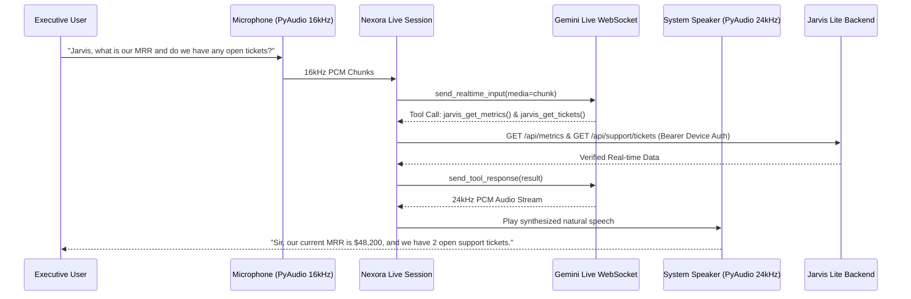

# GEMINI LIVE VOICE INTEGRATION ARCHITECTURE

## 1. Overview

Nexora connects directly to Google's Gemini Live API via bidirectional WebSockets using `google.genai.Client`:
- **Model**: `models/gemini-2.5-flash-native-audio-preview-12-2025`
- **Upstream Input**: 16,000 Hz, 1-channel, 16-bit PCM Audio (`audio/pcm`) captured continuously from the default microphone via PyAudio.
- **Downstream Output**: 24,000 Hz, 1-channel, 16-bit PCM Audio streamed back in real-time chunks and played through system speakers.
- **Latency**: Sub-second full duplex conversational response with native barge-in (interruption detection).

---

## 2. Audio Pipeline Flow

---

## 3. Web Radar Voice HUD (`NexoraVoiceBridge.tsx`)

In addition to the desktop Python voice engine, the web dashboard includes a built-in voice interface powered by Web Speech API:
- Visual animated HUD with frequency ripple radar.
- Real-time transcript display.
- One-click quick actions: "Executive Briefing", "Check MRR", "Show Ad ROAS", "Open Tickets".
- Direct integration with local Nexora WebSocket on `ws://127.0.0.1:8765`.
